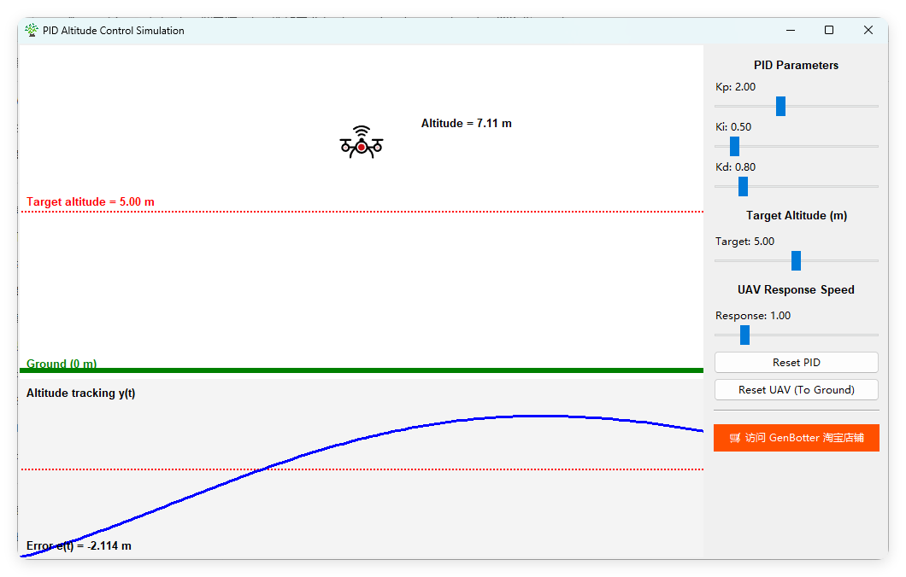

# 🚁 PID的Kp、Ki、Kd作用的效果演示

[](https://genbotter.taobao.com)

一个基于PID控制的无人机高度控制系统仿真平台，提供直观的GUI界面用于PID参数调节和实时可视化。



## ✨ 功能特性

- **实时PID控制仿真**：模拟无人机在垂直方向的起降控制
- **交互式参数调整**：通过滑块实时调整PID参数
- **可视化反馈**：
  - 无人机高度实时显示
  - 目标高度设定
  - 误差曲线可视化
  - 地面参考线
- **一键重置功能**：
  - 重置PID参数到初始值
  - 重置无人机到地面位置
- **响应速度调节**：可调整无人机系统的动态响应特性

## 📋 系统要求

- Python 3.8 或更高版本
- Windows / macOS / Linux

## 🔧 安装步骤

### 1. 克隆仓库

```bash
git clone https://gitee.com/gaoyanzeng/genbotter_motor_tutorial.git
cd 6.Python仿真/chap09pidsim/
```

### 2.安装依赖

```bash
pip install -r requirements.txt
```

## 🚀 快速开始

运行主程序：

```bash
python ./main.py
```

## 🎮 使用说明

### 控制面板

1. PID参数调节区
   1. Kp (比例增益)：控制系统的响应速度
   2. Ki (积分增益)：消除稳态误差
   3. Kd (微分增益)：抑制超调和振荡
2. 目标高度设置
   1. 滑动滑块设置期望的无人机目标高度 (0-最大高度)
3. 无人机响应速度
   1. 调节无人机系统的动态响应特性
4. 控制按钮
   1. Reset PID：重置PID参数到初始值
   2. Reset UAV (To Ground)：将无人机重置到地面位置

### 可视化区域

1. 左侧：无人机实时高度显示
2. 右侧：高度跟踪误差曲线
3. 底部：地面参考线 (0 m)

## 📁 项目结构

```text
CHAP09PIDSIM/
├── main.py # 程序主入口
├── readme.md # 项目说明文档
├── requirements.txt # 依赖包列表
├── controllers/ # 控制器模块
│ ├── pid.py # PID控制器实现
│ └── pycache/
│
├── gui/ # 图形用户界面
│ ├── main_window.py # 主窗口框架
│ ├── control_panel.py # 控制面板组件
│ ├── canvas_view.py # 可视化画布组件
│ ├── assets/ # GUI资源文件
│ └── pycache/
│
├── models/ # 模型模块
│ ├── uav.py # 无人机动力学模型
│ └── pycache/
│
├── simulations/ # 仿真引擎
│ ├── hover_sim.py # 悬停仿真器
│ └── pycache/
│
├── utils/ # 工具函数
│ ├── mapping.py # 坐标映射工具
│ └── pycache/
│
├── readme_pics/ # 文档图片资源
│ └── main_window.png
```

## 注意

- 如有问题请直接在issues提交。
