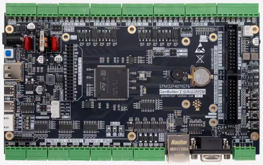
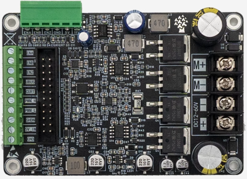
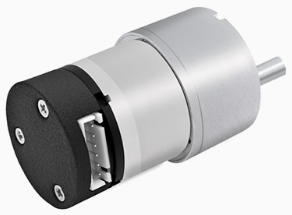
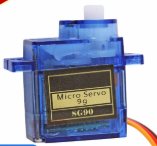
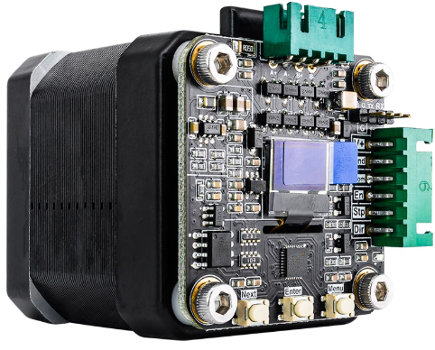
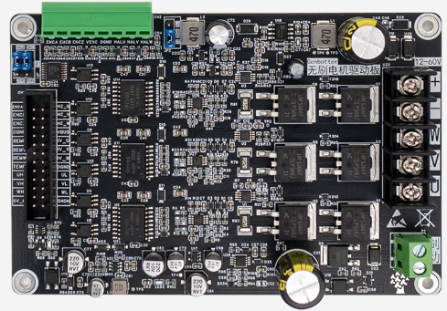

# GenBotter电机教程配套资源

本仓库为 **电机开发教程视频** 提供配套学习资源，包括原理图、案例代码、课件及用户手册等，帮助学习者快速上手电机开发与应用。

> B站：<https://space.bilibili.com/486637340>  
> 淘宝：<https://genbotter.taobao.com>

---

## 🎬 视频教程

B站完整视频教程请点击：  
👉 [电机开发教程 - B站链接](https://www.bilibili.com/video/BV122JEzaE2n/)

---

## 🛒 学习配套硬件购买

> 教程所用的电机开发板、电机驱动板及配套电机等硬件资源，可在淘宝店铺购买：  
👉 [GenBotter 淘宝店铺](https://genbotter.taobao.com)

---

## 📂 资源清单

本仓库包含以下学习资料（**正在持续更新**）：

| 目录  | 说明   |
|------|-------|
| `📐 1.原理图`   | 电机开发板与驱动板的完整电路原理图。|
| `📽️ 2.PPT课件`  | 视频课程配套讲解PPT，便于教学和复习。|
| `💻 3.案例代码` | 教程中涉及的案例的参考代码。|
| `📖 4.用户手册` | 板载硬件的功能说明、使用方法及注意事项。|
| `🏗️ 5.模板工程` | 可直接导入开发环境的工程模板，包含基础配置与常用外设初始化代码。|
| `🐍 6.Python仿真` | 用 Python 一些仿真演示的小应用。 |

---

## 🖼️ 学习配套硬件展示

> 📌 以下为本教程涉及的主要硬件资源：

| 硬件 | 图片 |
|------|------|
| 电机开发板 |  |
| 有刷电机驱动板 |  |
| 直流有刷电机 |  |
| SG90舵机 | |
| 闭环步进电机 |  |
| 无刷电机驱动板| |

---

## 💬 联系与交流

如果在学习过程中有问题或建议，欢迎在 **Issue** 区提交，或通过淘宝店铺与我们联系。
